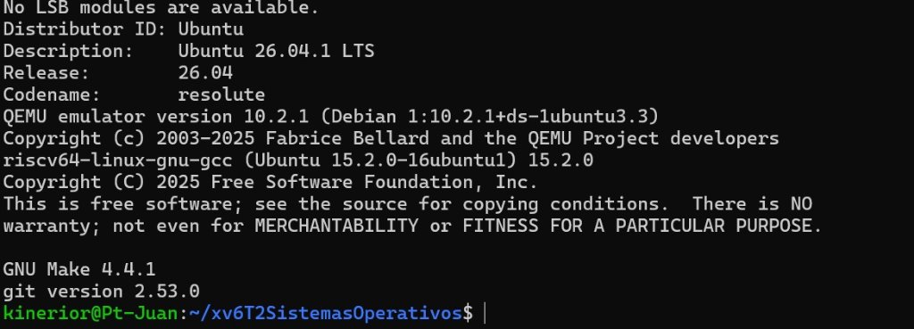
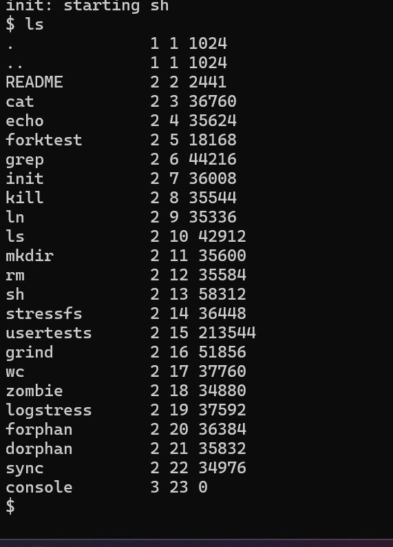
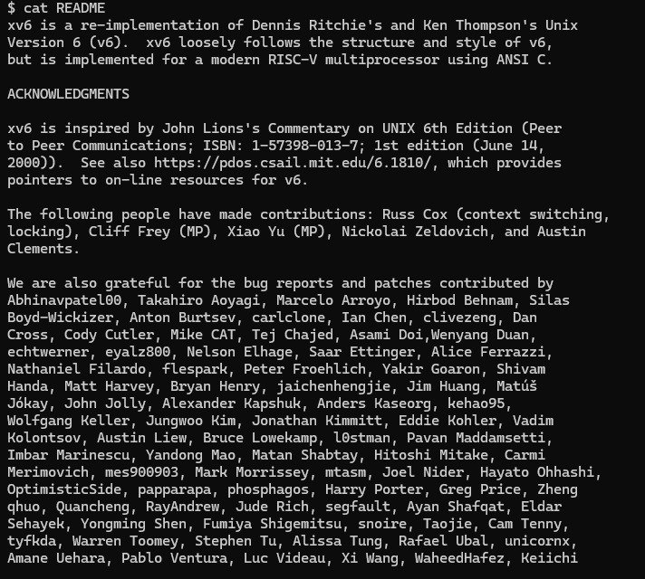
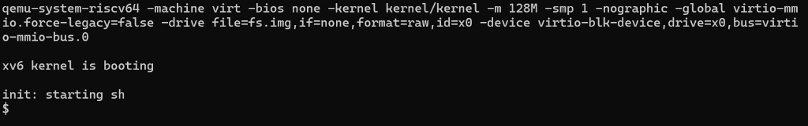
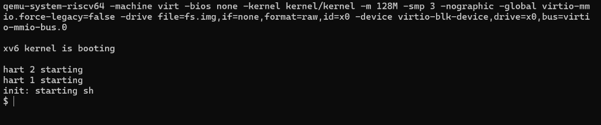
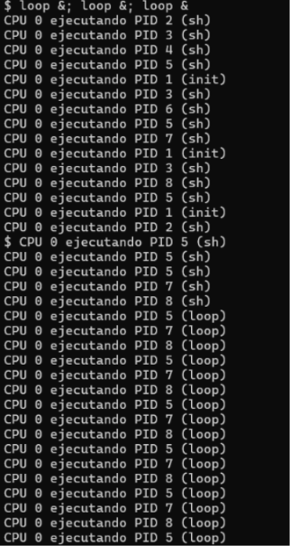

# Exploración de la planificación de procesos en XV6

**Curso:** Sistemas Operativos — Universidad del Valle (EISC)
**Integrantes:**
- Juan David Sánchez Navarro — código 2438810
- Santiago Barragán Triana — código 2521997

**Repositorio:** https://github.com/sant2111/xv6T2SistemasOperativos

---

## 1. Preparación del repositorio y el entorno

### 1.1 Sistema operativo donde se clonó el código

El código se clonó y compiló en **Ubuntu 26.04.1 LTS** (codename *resolute*), ejecutado mediante **WSL2** sobre Windows 11.

### 1.2 Commit de partida

Se creó un fork del repositorio oficial [mit-pdos/xv6-riscv](https://github.com/mit-pdos/xv6-riscv) y se clonó con:

```bash
git clone https://github.com/sant2111/xv6T2SistemasOperativos.git
cd xv6T2SistemasOperativos
git log -1
```

**Commit de partida:** `fa2ddcb7ca87a77af579380a6eafd5aff163b44f` (rama `riscv`, 30 de octubre de 2026)

### 1.3 Herramientas instaladas y versiones

Instalación en Ubuntu:

```bash
sudo apt-get update && sudo apt-get upgrade -y
sudo apt-get install -y git build-essential gdb-multiarch qemu-system-misc gcc-riscv64-linux-gnu binutils-riscv64-linux-gnu
sudo apt install -y qemu-system-riscv
```

> **Nota:** en Ubuntu 26.04 el paquete `qemu-system-misc` ya no incluye el emulador de RISC-V; fue necesario instalar `qemu-system-riscv` por separado para obtener `qemu-system-riscv64`.

| Herramienta | Versión |
|---|---|
| Ubuntu (WSL2) | 26.04.1 LTS |
| QEMU (`qemu-system-riscv64`) | 10.2.1 |
| GCC RISC-V (`riscv64-linux-gnu-gcc`) | 15.2.0 |
| GNU Make | 4.4.1 |
| Git | 2.53.0 |



---

## 2. Compilación y ejecución de XV6

### 2.1 Evidencia de XV6 operativo

Se compiló y ejecutó el sistema con:

```bash
make qemu
```

Una vez arrancado el sistema (mensaje `init: starting sh` y prompt `$`), se ejecutaron los comandos `ls` y `cat README`.



Al ejecutar `ls` se muestran los archivos del directorio raíz del sistema de archivos de XV6, la mayoría programas de usuario (`cat`, `ls`, `sh`, etc.). Cada línea sigue un formato: primero el nombre del archivo; en la siguiente columna el tipo, siendo 1 = directorio, 2 = archivo y 3 = dispositivo; luego el número de inodo; y al final el tamaño del archivo en bytes.



El `README` muestra información general de XV6 (una reimplementación de Unix Version 6 para RISC-V), los créditos de los colaboradores del sistema, una sección para contactar en caso de presentar errores y las instrucciones para compilarlo y ejecutarlo.

Al poder ejecutar estos comandos, comprobamos que XV6 está corriendo correctamente. Que la consola muestre el símbolo `$` nos indica que el sistema arrancó completo y que el shell está listo para recibir órdenes. `ls` es un programa de usuario, así que al ejecutarlo se demuestra que el sistema puede ejecutar programas y que el sistema de archivos se puede leer. Y `cat README` demuestra que se pueden abrir archivos y leer su contenido.

### 2.2 Ejecución con una sola CPU virtual

**Dónde se configura el número de CPUs.** Se buscó la variable `CPUS` en el `Makefile`:

```bash
grep -n "CPUS" Makefile
```

```text
174:ifndef CPUS
175:CPUS := 3
178:QEMUOPTS = -machine virt -bios none -kernel $K/kernel -m 128M -smp $(CPUS) -nographic
```

- **Líneas 174–175:** si `CPUS` no se define al invocar `make`, toma el valor por defecto `3`. Por eso XV6 arranca con 3 CPUs virtuales si no se indica otra cosa.
- **Línea 178:** el valor de `CPUS` se pasa a QEMU mediante la opción `-smp $(CPUS)`, que determina cuántos procesadores (*harts*, en la terminología de RISC-V) tiene la máquina emulada.

**Comando utilizado.** Gracias al `ifndef`, no es necesario modificar el `Makefile`; basta con definir la variable al ejecutar:

```bash
make CPUS=1 qemu
```

**Evidencia de que XV6 se ejecuta con una sola CPU virtual.**

Salida de `make CPUS=1 qemu`:

```text
qemu-system-riscv64 -machine virt -bios none -kernel kernel/kernel -m 128M -smp 1 -nographic -global virtio-mmio.force-legacy=false -drive file=fs.img,if=none,format=raw,id=x0 -device virtio-blk-device,drive=x0,bus=virtio-mmio-bus.0

xv6 kernel is booting

init: starting sh
$
```

Se observan dos evidencias:

1. **La opción `-smp 1`** en el comando con que `make` lanza QEMU: la máquina virtual se crea con un único procesador.
2. **Los mensajes de arranque:** solo aparece `xv6 kernel is booting` (lo imprime la CPU 0). Con la configuración por defecto (`make qemu`, 3 CPUs) aparecen además `hart 1 starting` y `hart 2 starting`, uno por cada CPU adicional que se inicializa. Con `CPUS=1` esas líneas no aparecen.

Para comparar, salida de `make qemu` con la configuración por defecto (3 CPUs):

```text
qemu-system-riscv64 -machine virt -bios none -kernel kernel/kernel -m 128M -smp 3 -nographic -global virtio-mmio.force-legacy=false -drive file=fs.img,if=none,format=raw,id=x0 -device virtio-blk-device,drive=x0,bus=virtio-mmio-bus.0

xv6 kernel is booting

hart 2 starting
hart 1 starting
init: starting sh
$
```

Aquí QEMU se lanza con `-smp 3` y aparecen los mensajes de las CPUs adicionales (*hart* 1 y *hart* 2). El orden en que aparecen (`hart 2` antes que `hart 1`) no es fijo, porque las CPUs arrancan en paralelo. La diferencia entre ambas salidas confirma que con `CPUS=1` solo existe la CPU 0.





Lo que nos demuestra que hay una sola CPU es que, al ejecutar `make CPUS=1 qemu`, en el comando con el que `make` lanza QEMU aparece la opción `-smp 1`, indicándonos que solamente estamos usando una CPU: `-smp $(CPUS)` toma el valor de `CPUS` y lo pasa como número de CPUs virtuales. El detalle que lo comprueba son los mensajes de la consola `hart N starting`, que solo aparecen cuando se usa más de una CPU: con `CPUS=1` no aparece ninguno, mientras que con la configuración por defecto (3 CPUs) aparecen `hart 1 starting` y `hart 2 starting`. Estos mensajes los imprime la función `main()` de `kernel/main.c` en cada CPU distinta de la CPU 0.

---

## 3. Investigación del planificador original

### Ubicación del planificador en el código

```bash
grep -n "scheduler" kernel/*.c kernel/*.h
```

```text
kernel/main.c:44:  scheduler();
kernel/proc.c:429:scheduler(void)
kernel/proc.c:472:// Switch to scheduler.  Must hold only p->lock
kernel/defs.h:95:void            scheduler(void) __attribute__((noreturn));
kernel/proc.h:24:  struct context context; // swtch() here to enter scheduler().
```

| Archivo:línea | Qué es |
|---|---|
| `kernel/proc.c:429` | Definición de `scheduler()` |
| `kernel/main.c:44` | Cada CPU llama a `scheduler()` al terminar de inicializarse |
| `kernel/defs.h:95` | Declaración; `noreturn` indica que nunca retorna (ciclo infinito) |
| `kernel/proc.c` (`sched()`) | Función con la que un proceso devuelve el control al planificador |
| `kernel/proc.h:24` | `context`: registros guardados de cada proceso para pausarlo y reanudarlo |

### Fragmento: `scheduler()` — `kernel/proc.c`

```c
void
scheduler(void)
{
  struct proc *p;
  struct cpu *c = mycpu();

  c->proc = 0;
  for (;;) {
    intr_on();
    intr_off();

    int found = 0;
    for (p = proc; p < &proc[NPROC]; p++) {
      acquire(&p->lock);
      if (p->state == RUNNABLE) {
        p->state = RUNNING;
        c->proc = p;
        swtch(&c->context, &p->context);

        mycpu()->intena = 0;
        c->proc = 0;
        found = 1;
      }
      release(&p->lock);
    }
    if (found == 0) {
      asm volatile("wfi");
    }
  }
}
```

### Fragmento: `sched()` y `yield()` — `kernel/proc.c`

```c
void
sched(void)
{
  int intena;
  struct proc *p = myproc();

  if (!holding(&p->lock))
    panic("sched p->lock");
  if (mycpu()->noff != 1)
    panic("sched locks");
  if (p->state == RUNNING)
    panic("sched RUNNING");
  if (intr_get())
    panic("sched interruptible");

  intena = mycpu()->intena;
  swtch(&p->context, &mycpu()->context);
  mycpu()->intena = intena;
}

// Give up the CPU for one scheduling round.
void
yield(void)
{
  struct proc *p = myproc();
  acquire(&p->lock);
  p->state = RUNNABLE;
  sched();
  release(&p->lock);
}
```

### Fragmento: quién provoca el `yield()` — `kernel/trap.c`

```bash
grep -n "yield" kernel/*.c
```

```text
kernel/proc.c:501:yield(void)
kernel/trap.c:86:    yield();
kernel/trap.c:158:    yield();
```

En `usertrap()` (interrupción mientras el proceso estaba en **modo usuario**):

```c
  } else if ((which_dev = devintr()) != 0) {
    // ok
  }
  ...
  // give up the CPU if this is a timer interrupt.
  if (which_dev == 2)
    yield();
```

En `kerneltrap()` (interrupción mientras se ejecutaba código del **kernel**):

```c
  if ((which_dev = devintr()) == 0) {
    ...
    panic("kerneltrap");
  }

  // give up the CPU if this is a timer interrupt.
  if (which_dev == 2 && myproc() != 0)
    yield();
```

### Fragmento: el temporizador y el *quantum* — `kernel/trap.c`

```bash
grep -n "clockintr\|stimecmp\|return 2" kernel/trap.c
```

```text
167:clockintr()
179:  w_stimecmp(r_time() + 1000000);
215:    clockintr();
216:    return 2;
```

### i. Algoritmo de planificación por defecto

El algoritmo que utiliza XV6 por defecto es **Round Robin**. El planificador está en el archivo `kernel/proc.c`, en la función `scheduler()`, la cual recorre con un `for` la tabla de procesos `proc[]` y asigna la CPU a un proceso. El `scheduler()` no tiene un criterio especial: simplemente escoge el siguiente proceso de la tabla `proc[]` que esté en estado `RUNNABLE` (listo para ejecutarse); si un proceso no está `RUNNABLE`, por ejemplo porque está `SLEEPING`, lo salta. Cuando encuentra uno, el `scheduler()` cambia su estado a `RUNNING` (`p->state = RUNNING`) y le entrega la CPU mediante `swtch()`, y en ese momento el proceso se está ejecutando. Aquí no se tiene en cuenta nada más que el orden de los procesos en la tabla `proc[]`: no hay ningún criterio de prioridad ni se considera cuánto dura cada proceso.

Lo que hace que un proceso deje la CPU sin haber terminado es la interrupción del temporizador. La función `clockintr()`, en `kernel/trap.c`, programa la siguiente interrupción del reloj para dentro de 1 000 000 ciclos, aproximadamente 0,1 s; ese tiempo es el **quantum**. Cuando la interrupción llega, las funciones `usertrap()` o `kerneltrap()` (también en `kernel/trap.c`) detectan que fue el temporizador (`which_dev == 2`) y llaman a `yield()`. La función `yield()`, en `kernel/proc.c`, cambia el estado del proceso de `RUNNING` a `RUNNABLE` y devuelve el control al `scheduler()`, que continúa recorriendo la tabla para darle la CPU al siguiente proceso listo.

Como ejemplo, si en la tabla `proc[]` están A, B y C en ese orden, y son procesos que no terminan en su primer turno, el orden de ejecución sería A → B → C → A → B → C, y así sucesivamente, con cada proceso usando la CPU durante un quantum.

Esto corresponde a Round Robin porque los procesos reciben turnos en orden circular, cada turno tiene el mismo tiempo máximo (el quantum) y ningún proceso tiene prioridad sobre otro. Una ventaja de este algoritmo es que no necesita conocer de antemano cómo se van a comportar los procesos, lo que reduce su complejidad.

**Evidencia en el comportamiento del sistema:**

La documentación oficial respalda esta conclusión: según la versión web del libro de XV6 (capítulo 8, *Scheduling*, https://mit-pdos.github.io/xv6-riscv-book/sched.html), XV6 implementa una política de planificación simple que ejecuta cada proceso por turnos:

> *"The xv6 scheduler implements a simple scheduling policy that runs each process in turn. This policy is called round robin."*

En Round Robin, a cada proceso se le asigna un tiempo fijo de uso de CPU, el quantum. Si el proceso termina o se bloquea antes, entrega la CPU voluntariamente; de lo contrario, es interrumpido y debe esperar a que todos los demás procesos listos tengan su turno. En la teoría esto se describe como una cola FIFO; en XV6 se implementa recorriendo la tabla `proc[]` en orden circular, como se explicó arriba.

Para demostrarlo en el comportamiento del sistema se realizó la siguiente prueba (sugerida por la inteligencia artificial):

1. Se creó un programa de usuario, `user/loop.c`, con un bucle infinito de uso intensivo de CPU y sin operaciones de E/S:

```bash
cat << 'EOF' > ~/xv6T2SistemasOperativos/user/loop.c
#include "kernel/types.h"
#include "kernel/stat.h"
#include "user/user.h"

int
main(void)
{
  while(1)
    ;
  exit(0);
}
EOF
```

2. Se agregó el programa a la lista `UPROGS` del `Makefile` (después de la línea 153):

```makefile
	$U/_forphan\
	$U/_dorphan\
	$U/_sync\
	$U/_loop\
```

3. Se agregó temporalmente un `printk` en `scheduler()` (`kernel/proc.c`), justo antes del `swtch()`, para imprimir cada vez que el planificador le entrega la CPU a un proceso:

```c
p->state = RUNNING;
c->proc = p;
printk("CPU %d ejecutando PID %d (%s)\n", cpuid(), p->pid, p->name);
swtch(&c->context, &p->context);
```

4. Se compiló y ejecutó XV6 con una sola CPU (`make CPUS=1 qemu`) y se lanzaron tres procesos `loop` en segundo plano:

```text
$ loop &; loop &; loop &
CPU 0 ejecutando PID 2 (sh)
CPU 0 ejecutando PID 3 (sh)
CPU 0 ejecutando PID 4 (sh)
CPU 0 ejecutando PID 5 (sh)
CPU 0 ejecutando PID 1 (init)
CPU 0 ejecutando PID 3 (sh)
CPU 0 ejecutando PID 6 (sh)
CPU 0 ejecutando PID 5 (sh)
CPU 0 ejecutando PID 7 (sh)
CPU 0 ejecutando PID 1 (init)
CPU 0 ejecutando PID 3 (sh)
CPU 0 ejecutando PID 8 (sh)
CPU 0 ejecutando PID 5 (sh)
CPU 0 ejecutando PID 1 (init)
CPU 0 ejecutando PID 2 (sh)
$ CPU 0 ejecutando PID 5 (sh)
CPU 0 ejecutando PID 5 (sh)
CPU 0 ejecutando PID 5 (sh)
CPU 0 ejecutando PID 7 (sh)
CPU 0 ejecutando PID 8 (sh)
CPU 0 ejecutando PID 5 (loop)
CPU 0 ejecutando PID 7 (loop)
CPU 0 ejecutando PID 8 (loop)
CPU 0 ejecutando PID 5 (loop)
CPU 0 ejecutando PID 7 (loop)
CPU 0 ejecutando PID 8 (loop)
CPU 0 ejecutando PID 5 (loop)
CPU 0 ejecutando PID 7 (loop)
CPU 0 ejecutando PID 8 (loop)
CPU 0 ejecutando PID 5 (loop)
CPU 0 ejecutando PID 7 (loop)
CPU 0 ejecutando PID 8 (loop)
CPU 0 ejecutando PID 5 (loop)
```



**Explicación del resultado y por qué demuestra Round Robin:**

Al ejecutar `loop &; loop &; loop &` se crean tres procesos `loop` en segundo plano, cuyo código, al ser un bucle infinito, consume CPU ininterrumpidamente sin realizar operaciones de E/S. Gracias al `printk` en el planificador, justo antes de que le entregue la CPU a un proceso, podemos ver en la consola qué proceso está ejecutando la CPU en cada momento.

Al inicio aparece `sh`, el intérprete de comandos, que se encarga de gestionar lo que el usuario escribe en la consola y de crear los procesos (los procesos que se van a convertir en `loop` aparecen primero con el nombre `sh`, porque son copias del shell creadas con `fork()` antes de ejecutar `loop`). También aparece `init`, que tiene un trabajo estructural: configura la entrada y salida estándar, ejecuta el shell y recoge los procesos huérfanos o zombis.

Luego se observan los tres procesos `loop`, con PID 5, 7 y 8, que se alternan de forma cíclica y repetitiva indefinidamente: 5 → 7 → 8 → 5 → 7 → 8… Esto demuestra que XV6 usa Round Robin: como los `loop` son bucles infinitos, nunca terminan ni sueltan la CPU por su cuenta, así que es el planificador, mediante la interrupción del temporizador y `yield()`, quien los interrumpe al terminar su quantum y le da el turno al siguiente proceso listo, en el mismo orden circular de la tabla `proc[]`. Si, por ejemplo, XV6 usara una política FIFO sin expropiación, el primer `loop` (PID 5) se quedaría con la CPU para siempre y los otros dos nunca tendrían tiempo de ejecución.

**Nota:** el `printk` y el programa `loop` fueron solo para la prueba. Para revertir el cambio y volver al estado original del sistema operativo se ejecutó:

```bash
cd ~/xv6T2SistemasOperativos
git checkout -- kernel/proc.c Makefile
rm -f user/loop.c user/loop.* user/_loop fs.img
make fs.img
git status
```

### ii. Archivo y función donde se selecciona el siguiente proceso

La selección del siguiente proceso se produce en la función `scheduler()`, ubicada en `kernel/proc.c` (línea 429). Esta función es llamada por la función `main()` de `kernel/main.c` (línea 44), y es lo último que hace cada CPU al terminar de arrancar. `scheduler()` nunca termina, ya que no retorna de nuevo a `main()`, sino que se queda en el ciclo infinito `for (;;)`. Esto también se indica en su declaración en `kernel/defs.h` (línea 95), `void scheduler(void) __attribute__((noreturn));`, donde `noreturn` le indica al compilador que la función no retorna.

La parte que selecciona qué proceso correr es el ciclo `for (p = proc; p < &proc[NPROC]; p++)`, que recorre con el puntero `p` la tabla `proc[]` donde están los procesos, junto con la condición `if (p->state == RUNNABLE)`, que decide si ese proceso puede entrar: si su estado es `RUNNABLE`, da el visto bueno para que pase a ejecutarse. Entonces se cambia su estado a `RUNNING` (`p->state = RUNNING;`), se registra que esa CPU está ejecutando ese proceso (`c->proc = p;`) y se le entrega la CPU con `swtch(&c->context, &p->context);`, que es el que permite hacer ese cambio.

Si el `for` recorre toda la tabla y no encuentra ningún proceso `RUNNABLE` (`found == 0`), se ejecuta la instrucción `wfi` (*wait for interrupt*, "esperar una interrupción"). `wfi` no es un estado del proceso, sino una instrucción de RISC-V que detiene la CPU hasta que llegue una interrupción, por ejemplo del temporizador o del disco, que puede haber hecho que algún proceso vuelva a estar listo. Así se evita recorrer la tabla una y otra vez inútilmente.

Hay otras funciones que también participan:

- `swtch()`, ubicada en `kernel/swtch.S` (escrita en ensamblador), es la que hace el **cambio de contexto**: guarda los registros de quien sale de la CPU y carga los de quien entra. Es como el puente o interruptor entre el planificador y los procesos.
- `sched()`, ubicada en `kernel/proc.c`, es el camino de regreso: devuelve la CPU al `scheduler()` (usando `swtch()`), para que este pueda volver a escoger qué proceso ejecutar.
- `yield()`, ubicada en `kernel/proc.c`, es la que se llama cuando termina el quantum de un proceso (interrupción del temporizador): cambia el estado del proceso a `RUNNABLE` y llama a `sched()` para devolverle la CPU al `scheduler()`. El proceso queda listo y volverá a ejecutarse cuando el `scheduler()` le dé otro turno.

El fragmento de `scheduler()` que respalda esta respuesta se encuentra al inicio de esta sección.

### iii. Relación con los estados de los procesos y los eventos

Los 6 estados de un proceso están definidos en `kernel/proc.h` (línea 79):

- `UNUSED`: la entrada de la tabla `proc[]` está libre; ahí todavía no hay ningún proceso.
- `USED`: se reservó un lugar dentro de `proc[]` y el proceso se está creando (`allocproc()`).
- `RUNNABLE`: el proceso ya está listo para ejecutarse y espera que el `scheduler()` lo elija. A este estado se llega desde varias funciones: `userinit()` y `kfork()` (al crearse), `yield()` (al terminar su quantum) y `wakeup()` o `kkill()` (al ser despertado).
- `RUNNING`: el proceso está corriendo dentro de la CPU.
- `SLEEPING`: el proceso está detenido esperando que ocurra un evento, por ejemplo que termine una operación de entrada/salida o que termine un hijo cuando el padre usa `wait()`.
- `ZOMBIE`: el proceso ya terminó (con `exit`), pero su padre todavía no ha recogido su estado de salida con `wait()`; cuando lo hace, la entrada se libera y vuelve a `UNUSED`.

**El proceso que va a entrar a la CPU** debe estar en estado `RUNNABLE`. El `for` de `scheduler()` recorre la tabla, lo encuentra y lo pasa a `RUNNING` (`kernel/proc.c`, línea 451).

**El proceso que está en la CPU** puede cederla de tres maneras:

1. `yield()` (`kernel/proc.c`, línea 505): cuando llega la interrupción del temporizador porque terminó su quantum, el manejador de interrupciones llama a `yield()`, que deja al proceso en `RUNNABLE` y devuelve el acceso de la CPU al `scheduler()`. El proceso sigue listo y volverá a ejecutarse en su próximo turno.
2. `sleep()` (`kernel/proc.c`, línea 568): el proceso pasa a `SLEEPING` y se detiene hasta que ocurra el evento que espera, por ejemplo que termine una lectura del disco o que termine un proceso hijo.
3. `kexit()` (`kernel/proc.c`, línea 358): da por terminado el proceso, lo deja en `ZOMBIE` y devuelve el acceso al `scheduler()`. Ese proceso no vuelve a ejecutarse.

Estas tres maneras siempre llaman a `sched()`, ya que es el puente que nos permite llegar al `scheduler()`. Por eso `sched()` exige que el proceso ya haya cambiado su estado y no siga en `RUNNING`.

**Recuperar la CPU:** un proceso solo puede volver a ejecutarse si está en `RUNNABLE`. Los eventos que lo llevan a ese estado son:

| Función | Transición | Evento |
|---|---|---|
| `kfork()` | `USED` → `RUNNABLE` | El hijo creado con `fork()` queda listo |
| `yield()` | `RUNNING` → `RUNNABLE` | Interrupción del temporizador: cede la CPU pero sigue listo |
| `wakeup()` | `SLEEPING` → `RUNNABLE` | Ocurrió el evento esperado: vuelve a estar listo |
| `kkill()` | `SLEEPING` → `RUNNABLE` | Se despierta a un proceso dormido para que pueda terminar |

Un proceso en `SLEEPING` no desperdicia CPU porque el `scheduler()` solo elige procesos `RUNNABLE`: cuando recorre la tabla y encuentra uno en `SLEEPING`, simplemente lo salta. El proceso sigue existiendo en la tabla `proc[]`, pero no recibe tiempo de CPU hasta que un `wakeup()` lo vuelva a poner en `RUNNABLE`.

**Ejemplo: un proceso que lee del teclado.**

1. El proceso está `RUNNING` y pide leer una tecla (`read`).
2. Todavía no se ha presionado ninguna tecla, así que el proceso llama a `sleep()`: pasa a `SLEEPING` y, mediante `sched()`, devuelve la CPU al `scheduler()`, que le da turnos a otros procesos.
3. El usuario presiona una tecla. Llega una interrupción de la consola y el kernel llama a `wakeup()`, que pasa el proceso a `RUNNABLE`. Todavía no se ejecuta, solo queda listo.
4. Cuando el `for` de `scheduler()` llega a su posición en la tabla, lo pasa a `RUNNING` y el proceso continúa leyendo la tecla.

Secuencia de estados: `RUNNING` → `SLEEPING` → `RUNNABLE` → `RUNNING`.

**Fragmento: estados posibles — `kernel/proc.h`**

```c
enum procstate { UNUSED, USED, SLEEPING, RUNNABLE, RUNNING, ZOMBIE };
...
  enum procstate state; // Process state
  void *chan;           // If non-zero, sleeping on chan
```

| Estado | Significado |
|---|---|
| `UNUSED` | Entrada libre de la tabla `proc[]` |
| `USED` | Entrada reservada, el proceso se está creando |
| `RUNNABLE` | Listo: puede ejecutarse, espera que el planificador lo elija |
| `RUNNING` | Ejecutándose en una CPU |
| `SLEEPING` | Bloqueado esperando un evento (I/O, `wait`, etc.); `chan` indica qué evento |
| `ZOMBIE` | Terminó, pero su padre aún no ha recogido su estado de salida |

**Mapa de transiciones de estado — `kernel/proc.c`**

```bash
grep -n "state = " kernel/proc.c
```

```text
56:    p->state = UNUSED;
126:  p->state = USED;
170:  p->state = UNUSED;
228:  p->state = RUNNABLE;
301:  np->state = RUNNABLE;
358:  p->state = ZOMBIE;
451:        p->state = RUNNING;
505:  p->state = RUNNABLE;
568:    p->state = SLEEPING;
590:        p->state = RUNNABLE;
614:        p->state = RUNNABLE;
```

| Línea | Función | Transición | Evento |
|---|---|---|---|
| 56 | `procinit()` | → `UNUSED` | Al arrancar, toda la tabla queda libre (recorre `proc[]`, inicializa el lock de cada entrada y la marca `UNUSED`) |
| 126 | `allocproc()` | `UNUSED` → `USED` | Se reserva una entrada para un proceso nuevo |
| 228 | `userinit()` | `USED` → `RUNNABLE` | El primer proceso (`init`) queda listo |
| 301 | `kfork()` | `USED` → `RUNNABLE` | El hijo creado con `fork()` queda listo |
| 451 | `scheduler()` | `RUNNABLE` → `RUNNING` | **El planificador le entrega la CPU** |
| 505 | `yield()` | `RUNNING` → `RUNNABLE` | **Interrupción del temporizador: cede la CPU pero sigue listo** |
| 568 | `sleep()` | `RUNNING` → `SLEEPING` | **Espera un evento (p. ej. I/O): cede la CPU y no está listo** |
| 590 | `wakeup()` | `SLEEPING` → `RUNNABLE` | **Ocurrió el evento esperado: vuelve a estar listo** |
| 614 | `kkill()` | `SLEEPING` → `RUNNABLE` | Se despierta a un proceso dormido para que pueda terminar |
| 358 | `kexit()` | `RUNNING` → `ZOMBIE` | **El proceso termina y cede la CPU para siempre** |
| 170 | `freeproc()` | `ZOMBIE` → `UNUSED` | El padre recoge al hijo (`wait`) y se libera la entrada: borra la tabla de páginas, el `pid`, el `chan`, `killed` y `xstate`, y marca la entrada `UNUSED` |

**Fragmento: `sleep_prepare()`, `sleep()` y `wakeup()` — `kernel/proc.c`**

```c
// Register current process as waiting for wakeups on chan.
void
sleep_prepare(void *chan)
{
  struct proc *p = myproc();

  acquire(&p->lock);
  if (chan == 0)
    panic("sleep_prepare: zero chan");
  p->chan = chan;
  release(&p->lock);
}

// Put the thread to sleep.  Assumes sleep_prepare() was called before.
// If the channel registered by sleep_prepare() has been woken up in
// the meantime, do not go to sleep, and instead return immediately.
void
sleep(void)
{
  struct proc *p = myproc();

  acquire(&p->lock);
  if (p->chan != 0) {
    p->state = SLEEPING;
    sched();
  }
  release(&p->lock);
}

// Wake up all processes sleeping on channel chan.
void
wakeup(void *chan)
{
  struct proc *p;

  for (p = proc; p < &proc[NPROC]; p++) {
    acquire(&p->lock);
    if (p->chan == chan) {
      p->chan = 0;
      // If this waiting process has gotten so far as to actually
      // go to sleep, also set it back to RUNNING.
      if (p->state == SLEEPING) {
        p->state = RUNNABLE;
      }
    }
    release(&p->lock);
  }
}
```

*Observaciones sobre el código:*
- **Diferencia con el libro de XV6:** en esta versión del código, dormir está dividido en dos funciones: `sleep_prepare(chan)` registra el evento que se espera y `sleep()` duerme solo si ese evento todavía no ocurrió (`p->chan != 0`). Así se evita perder un `wakeup` que llegue entre ambos pasos. Lo describimos según el código observado, no según el libro.
- `wakeup(chan)` recorre toda la tabla y despierta a **todos** los procesos que esperan ese `chan`, pasándolos a `RUNNABLE`. No los ejecuta de inmediato: solo quedan listos, y será `scheduler()` quien los elija en su turno.
- **Observación:** el comentario de `wakeup()` dice *"set it back to RUNNING"*, pero el código asigna `RUNNABLE`. El comentario es impreciso; lo que cuenta es el código.

### iv. Incorporación del planificador durante la compilación

El código del planificador está repartido en tres archivos: `kernel/proc.c` (`scheduler()`, `sched()`, `yield()`, las funciones que modifican el estado de los procesos y la tabla `proc[]`), `kernel/swtch.S` (el cambio de contexto en ensamblador, que guarda y restaura registros) y `kernel/trap.c` (la interrupción del temporizador y la llamada a `yield()`).

En el `Makefile`, la variable `OBJS` (línea 4) es la lista de archivos objeto (`.o`) que forman el kernel completo. Entre ellos están `kernel/proc.o`, `kernel/swtch.o` y `kernel/trap.o` (líneas 15, 16 y 18).

La construcción se hace en dos pasos:

1. **Compilación:** cada `.c` o `.S` se compila a su `.o` con el compilador cruzado `riscv64-linux-gnu-gcc`, con la opción `-march=rv64gc`, porque XV6 corre sobre RISC-V y no sobre la arquitectura x86 del computador.
2. **Enlazado:** la regla de las líneas 94–95 (`$K/kernel: $(OBJS) $K/kernel.ld`) usa el enlazador `riscv64-linux-gnu-ld` para unir todos los `.o` de `OBJS` en un único ejecutable, `kernel/kernel`, con el *linker script* `kernel/kernel.ld`, que define en qué direcciones de memoria se ubica el código.

Ese `kernel/kernel` es el que QEMU carga al arrancar: en el comando de la sección 2.2 aparece la opción `-kernel kernel/kernel`. Finalmente, cuando el sistema arranca, la función `main()` (`kernel/main.c`, línea 44) llama a `scheduler()`, y desde ese momento el planificador empieza a funcionar.

Así, el planificador no es un programa aparte: queda dentro del binario del kernel, y empieza a ejecutarse cuando `main()` llama a `scheduler()`. La evidencia de la compilación y el enlazado se muestra a continuación.

**Fragmento: lista de objetos y enlazado del kernel — `Makefile`**

```bash
grep -n "OBJS\|proc.o\|swtch.o\|trap.o\|kernel.ld\|^\$K/kernel:" Makefile
```

```text
4:OBJS = \
15:  $K/proc.o \
16:  $K/swtch.o \
18:  $K/trap.o \
20:  $K/sysproc.o \
94:$K/kernel: $(OBJS) $K/kernel.ld
95:     $(LD) $(LDFLAGS) -T $K/kernel.ld -o $K/kernel $(OBJS)
```

**Evidencia de la compilación y el enlazado:**

```bash
make clean && make 2>&1 | grep -E "proc|swtch|trap|kernel.ld"
```

```text
riscv64-linux-gnu-gcc -Wall -Werror ... -march=rv64gc ... -c -o kernel/proc.o kernel/proc.c
riscv64-linux-gnu-gcc -march=rv64gc -g ... -c -o kernel/swtch.o kernel/swtch.S
riscv64-linux-gnu-gcc -Wall -Werror ... -march=rv64gc ... -c -o kernel/trap.o kernel/trap.c
riscv64-linux-gnu-gcc -Wall -Werror ... -march=rv64gc ... -c -o kernel/sysproc.o kernel/sysproc.c
riscv64-linux-gnu-ld -z max-page-size=4096 -T kernel/kernel.ld -o kernel/kernel kernel/entry.o kernel/start.o kernel/console.o kernel/printk.o kernel/uart.o kernel/kalloc.o kernel/spinlock.o kernel/string.o kernel/main.o kernel/vm.o kernel/proc.o kernel/swtch.o kernel/trampoline.o kernel/trap.o kernel/syscall.o kernel/sysproc.o kernel/bio.o kernel/fs.o kernel/log.o kernel/sleeplock.o kernel/file.o kernel/pipe.o kernel/exec.o kernel/sysfile.o kernel/kernelvec.o kernel/plic.o kernel/virtio_disk.o
```

*(Las opciones del compilador se abreviaron con `...`.)*

**Fragmento: arranque del kernel — `kernel/main.c`**

```c
// start() jumps here in supervisor mode on all CPUs.
void
main()
{
  if (cpuid() == 0) {
    ...
    printk("xv6 kernel is booting\n");
    ...
    procinit();         // process table
    trapinit();         // trap vectors
    trapinithart();     // install kernel trap vector
    ...
    userinit();         // first user process

    __atomic_store_n(&started, 1, __ATOMIC_RELEASE);
  } else {
    while (__atomic_load_n(&started, __ATOMIC_ACQUIRE) == 0)
      ;

    printk("hart %d starting\n", cpuid());
    kvminithart();  // turn on paging
    trapinithart(); // install kernel trap vector
    plicinithart(); // ask PLIC for device interrupts
  }

  scheduler();
}
```

---

## 4. MLFQ y su incorporación a XV6

### 4.1 Descripción inicial de MLFQ (escrita antes de consultar a la IA)

> Esta descripción se incluye tal como la escribimos, sin correcciones, porque es el punto de partida del diálogo socrático.

El algoritmo busca reducir el tiempo de ejecución de un proceso y reducir el tiempo de respuesta. El proceso no necesita conocer los detalles de los procesos, sino hasta que los empieza a ejecutar toma las decisiones. El Round Robin ni elegir el proceso más corto bastan porque si se rige de una sola manera de realizar los procesos no aplica la mejor solución para un caso en específico, como cuando elegimos solo por ser el más corto, podemos alargar procesos que son urgentes de ejecutar, y cuando se usa Round Robin, alargamos el tiempo de ejecución de un proceso que puede ser corto. El multinivel se refiere a las múltiples colas que puede tener, pudiendo elegir de varias opciones, y retroalimentación es que al ir ejecutando estas múltiples colas con diferentes prioridades, va retroalimentándose para ejecutarlas de una manera más óptima. Cuando están organizadas en la misma cola, el Round Robin es el método que se utiliza ya que tienen la misma prioridad. Si están en colas distintas pues se ejecuta la que tenga mayor prioridad, o sea la más alta es la que tiene mayor prioridad, y la baja de menor.

La prioridad de los procesos puede variar, esto depende de cómo se comporte el proceso: si este hace un uso demandante de la CPU su prioridad bajará, ya que se pueden ejecutar antes procesos menos demandantes reduciendo el tiempo de ejecución de los programas más livianos. Mientras que si un proceso libera la CPU de manera rápida, antes de su quantum de tiempo, la prioridad se conserva, ya que esto nos da a entender que el proceso es liviano y rápido de ejecutar. Cuando un proceso nuevo aparece, este tiene la máxima prioridad, así que iría en lo más alto de la cola; cuando un proceso termina su allotment su prioridad se reduce.

El problema de inanición es cuando hay un proceso que está al final de la cola y, por procesos que conservan su prioridad alta por cualquiera de sus reglas, este proceso va a quedar rezagado sin tener la posibilidad de ejecutarse. La manera de poder contrarrestarlo es programando que este proceso que requiere de la CPU y puede perder prioridad suelte la CPU antes de que el quantum termine y así su prioridad no se degrade, engañando al planificador.

El problema de que un proceso cambie de ser intensivo en CPU a entrada y salida es que pierde esa prioridad que tienen los procesos intensivos en CPU y al cambiar el comportamiento también pierde la prioridad, sin la capacidad de volver a recuperar la prioridad que tenía en su inicio cuando era intensivo en CPU, cayendo en inanición. Así mismo, una solución para la inanición es que luego de un tiempo definido todos los procesos sean enviados a la parte más alta de la cola de procesos, de tal manera que mediante Round Robin se puedan ejecutar todos los procesos.

Si un proceso mantiene su prioridad durante bastante tiempo, el mismo sistema operativo es capaz de reducir su prioridad, de tal manera que se puede llegar a evitar que un proceso creado de manera maliciosa consuma la CPU de manera indefinida. Realmente veo que es muy ambiguo el uso que se le puede dar a la cantidad de colas y al tiempo del quantum; así mismo, veo que el quantum conviene más que sea corto en las mayores prioridades y cada vez vaya aumentando, así se podría facilitar la ejecución de los procesos evitando que se llegue a inanición.

**Reglas, como las recordamos:**

1. Se ejecuta el proceso que está más arriba en la prioridad de la cola, y B no se ejecuta en ese lapso.
2. Si la prioridad de un proceso está en el mismo nivel de la cola, la ejecución que se usa es Round Robin.
3. Todo proceso nuevo que entra al sistema operativo tiene la mayor prioridad.
4. Cuando un proceso se usa durante un tiempo muy largo y mantiene su prioridad, el mismo sistema operativo se encarga de reducirla.
5. Luego de un tiempo establecido, todos los procesos, sin importar el orden de prioridad, se vuelven a subir a la prioridad más alta, reduciendo la inanición.

**Dudas identificadas:**

1. ¿Cómo hacer para que un proceso tenga una prioridad superior y use la CPU al máximo sin que pierda prioridad?
2. ¿Cómo escoger la mejor opción de tiempo para cada quantum, sin caer en usar Round Robin la mayor parte del tiempo al degradar o no degradar los procesos?
3. ¿Para qué me sirve darle prioridad a los procesos de entrada y salida y no a los de uso de CPU?

### 4.2 Descripción revisada de MLFQ (después del diálogo)

Esta es la variante de MLFQ que acordamos en el diálogo, con los valores de los parámetros que decidimos después.

**Reglas:**

1. **Prioridad (regla 1):** corre el proceso que esté en el nivel más alto con procesos listos. Si aparece un proceso de mayor prioridad mientras corre uno de un nivel inferior, este pierde la CPU en el **siguiente tic**, sin esperar a que termine su quantum. Al principio propusimos esperar a que terminara el quantum, pero lo cambiamos porque con un quantum largo (por ejemplo 200 ms en el nivel más bajo) un proceso interactivo tardaría unos 201 ms en responder, lo que contradice el objetivo de reducir el tiempo de respuesta.
2. **Mismo nivel (regla 2):** los procesos de un mismo nivel se reparten la CPU con Round Robin usando el quantum de ese nivel. Hay **una cola por nivel**, y el proceso que agota su quantum vuelve al final de la cola de su nivel. Elegimos colas en lugar de recordar en qué posición del recorrido de `proc[]` se quedó el planificador.
3. **Procesos nuevos (regla 3):** todo proceso nuevo entra al nivel más alto con su contador de tiempo en 0. (Al inicio escribimos "los que llegan de primero", lo que suena a FCFS; lo correcto es "los procesos nuevos".)
4. **Bajar de nivel (regla 4):** se cuenta solo el tiempo que el proceso pasa en `RUNNING`, de forma **acumulada**, aunque suelte la CPU antes de terminar el quantum (por ejemplo, para hacer E/S el contador no se reinicia). El tiempo en `SLEEPING` y en `RUNNABLE` no cuenta, porque el proceso no está usando la CPU. Cuando el tiempo acumulado supera el *allotment* del nivel, el proceso baja al final de la cola del nivel inferior y su contador vuelve a 0.
   - **Nivel más bajo:** un proceso que ya está en el nivel más bajo y agota su *allotment* se mantiene en ese nivel; lo que lo rescata es el boost.
5. **Boost (regla 5):** cada cierto periodo S, todos los procesos suben al nivel más alto y sus contadores vuelven a 0, para reiniciar la contabilidad. El boost es periódico: no lo dispara que un proceso agote su allotment.

**Parámetros:**

| Parámetro | Decisión | Justificación |
|---|---|---|
| Número de niveles | **3** (niveles 0, 1 y 2) | Con 3 niveles un proceso de cómputo no tiene que bajar tantas veces antes de llegar a su nivel, y como aplicamos el boost, no hace falta tener muchos niveles. |
| Convención de numeración | **Nivel 0 = el más alto** (mayor prioridad); el número aumenta en 1 al bajar | Los procesos nuevos entran al nivel 0 y bajan a 1 y 2. (En las figuras de OSTEP es al revés: Q0 es la cola más baja. Es una convención; lo importante es usarla igual en todo el diseño.) |
| Quantum por nivel | **1, 2 y 4 ticks** (≈ 0,1 s, 0,2 s y 0,4 s) | Corto arriba, donde quedan los procesos interactivos que necesitan respuesta rápida, y más largo abajo, donde los procesos de cálculo rinden más con turnos largos. Son múltiplos del tic de XV6 (≈ 0,1 s), porque no conviene cambiar el intervalo del temporizador (ver 4.3, cambio 5). |
| *Allotment* por nivel | **2, 4 y 8 ticks** (el doble del quantum de cada nivel) | Un proceso puede usar dos quantum completos en su nivel antes de bajar. En el nivel 2 el *allotment* no hace bajar al proceso, porque no hay un nivel inferior. |
| Periodo S del boost | **20 ticks** (≈ 2 s) | Es bastante mayor que el *allotment* más grande (8 ticks), para que los procesos alcancen a bajar de nivel, y suficientemente corto para que un proceso del nivel más bajo no caiga en inanición por mucho tiempo. Es del mismo orden que el boost de Solaris (≈ 1 s) mencionado en OSTEP. |

Estos valores son una propuesta inicial: OSTEP llama a este tipo de parámetros *voo-doo constants*, y habría que ajustarlos probando con cargas de trabajo reales (ver 4.4).

**Respuestas a nuestras dudas iniciales:**

- **Duda 1 (usar la CPU al máximo sin perder prioridad):** no es posible, porque el tiempo en `RUNNING` se acumula aunque el proceso no complete el quantum.
- **Duda 2 (valor del quantum):** quantums cortos arriba y largos abajo; los valores exactos quedan por definir.
- **Duda 3 (por qué priorizar los procesos de E/S):** usan poca CPU y casi siempre están esperando; si se atienden rápido, el sistema se siente ágil para el usuario.

### 4.3 Propuesta de cambios a XV6

| # | Archivo / función | Necesidad y regla relacionada | Evidencia en el código | Estado |
|---|---|---|---|---|
| 1 | `kernel/proc.h`, `struct proc`: campos nuevos `level` y `accumulated_time` | Saber en qué nivel está cada proceso (reglas 1 y 2) y cuánto tiempo lleva en `RUNNING` en su nivel (reglas 4 y 5). Descartamos guardar la hora de llegada, porque ninguna regla la usa. | Hoy `struct proc` no tiene ningún campo de prioridad. El comentario *"p->lock must be held when using these"* agrupa los campos que modifica el planificador; los nuevos irían en ese grupo. | Estructura y lock observados. Los campos son propuesta. |
| 2 | `kernel/proc.c`, `allocproc()` (línea 126) | Inicializar `level` en el nivel más alto y el contador en 0 (regla 3). | Es el punto común por donde pasan los procesos nuevos (es donde un proceso pasa a `USED`): `userinit()` lo llama en `kernel/proc.c:223` y `kfork()` en `kernel/proc.c:266`. | Verificado que ambos llaman a `allocproc()`. La inicialización es propuesta. |
| 3 | `kernel/proc.c`, `scheduler()` (línea 429): elegir por nivel usando colas | Reglas 1 y 2. | El `for` actual toma el primer `RUNNABLE` de `proc[]`, sin prioridades. Si se recorriera siempre desde `proc[0]` buscando el nivel más alto, un proceso P2 del mismo nivel que P1 nunca correría, porque en cada vuelta se encontraría primero a P1. | Problema observado en el código actual. La solución con colas es propuesta. |
| 4 | `kernel/proc.c`, `scheduler()`: leer `r_time()` justo antes del `swtch()` y justo al volver, y sumar la diferencia a `accumulated_time` | Regla 4, sin que un proceso pueda evitar que se le cuente el tiempo durmiéndose justo antes del tic. | `yield()`, `sleep()` y `kexit()` pasan por `sched()` y regresan al mismo `swtch()` de `scheduler()`. `r_time()` se puede leer en modo supervisor: `kernel/start.c:61-62` lo habilita con `w_mcounteren(r_mcounteren() \| 2)` y `clockintr()` ya lo usa (`kernel/trap.c:179`). | Comprobado que `r_time()` funciona en modo supervisor. El punto de medición es propuesta. |
| 5 | `kernel/trap.c`, `usertrap()` / `kerneltrap()`: dejar el tic igual y llamar a `yield()` solo cuando el proceso agota el quantum de su nivel | Quantums distintos por nivel (regla 2). | `ticks` (`kernel/trap.c:10`) lo usan `sys_sleep()` (`kernel/sysproc.c:71-88`) y `sys_uptime()` (`kernel/sysproc.c:106-111`); cambiar el intervalo del temporizador cambiaría lo que miden. | `ticks` observado. El mecanismo es propuesta (pendiente, ver 4.4). |
| 6 | `kernel/trap.c`, `clockintr()`: hacer el boost cada S | Regla 5. | `clockintr()` se ejecuta en cada tic e incrementa `ticks`, así que lleva el tiempo general del sistema, sin importar qué proceso esté corriendo. | Observado que `clockintr()` lleva el tiempo. El boost es propuesta. |
| 7 | Boost: recorrer `proc[]` tomando `p->lock` de cada proceso | Evitar que otra parte del kernel lea los campos de un proceso a medio modificar. | `struct spinlock lock` es el primer campo de `struct proc` y se usa con `acquire(&p->lock)`. | Observado. |
| 8 | Sacar y meter procesos de las colas al dormir, despertar o terminar | Que las colas no queden desactualizadas (regla 2). | Los puntos candidatos son las transiciones de estado de la sección 3.iii: entra a una cola al pasar a `RUNNABLE` (`userinit`, `kfork`, `yield`, `wakeup`, `kkill`) y sale al dejar de estarlo (`scheduler`, `sleep`, `kexit`). | Pendiente: no se definieron las funciones. |

### 4.4 Decisiones que requieren investigación o soporte adicional

**Verificado durante el trabajo:**

- **`r_time()` en modo supervisor:** sí se puede usar. `kernel/start.c:61-62` habilita el acceso con `w_mcounteren(r_mcounteren() | 2)` (comentario: *"allow supervisor to use stimecmp and time"*), y `kernel/trap.c:179` muestra que `clockintr()` ya lo usa.
- **Lock de cada proceso:** `struct spinlock lock` en `struct proc`. Los campos nuevos irían en el grupo protegido por `p->lock`.
- **`allocproc()` es el punto común de los procesos nuevos:** `grep -n "allocproc()" kernel/proc.c` muestra que lo llaman `userinit()` (línea 223, `p = allocproc();`) y `kfork()` (línea 266, `if ((np = allocproc()) == 0)`).
- **`ticks`:** declarado en `kernel/trap.c:10` junto con `tickslock`, e incrementado con `ticks++` en `clockintr()`. Lo usan `sys_sleep()` y `sys_uptime()`, por lo que no conviene cambiar el intervalo del temporizador. Además, `ticks++` solo ocurre `if (cpuid() == 0)`, es decir, solo lo cuenta la CPU 0.

**Pendiente de investigar o decidir:**

1. **Ajustar los valores propuestos** (3 niveles; quantum de 1, 2 y 4 ticks; *allotment* de 2, 4 y 8 ticks; S = 20 ticks). El capítulo de OSTEP llama a este tipo de valores *voo-doo constants*: habría que comprobarlos con cargas de trabajo reales, por ejemplo con los escenarios de 4.5.
2. En qué funciones exactas se sacan y se meten procesos de las colas.
3. Si el boost en `clockintr()` debe ocurrir en todas las CPU o solo en una (relacionado con que `ticks++` solo ocurre en la CPU 0).
4. En qué función se decide la bajada de nivel y se mueve el proceso a la cola inferior.
5. Dónde se aplica la expropiación "en el siguiente tic" cuando aparece un proceso de mayor prioridad.
6. **Observación de la IA, no discutida en el diálogo:** en el cambio 5, la trampa necesita saber cuánto lleva corriendo el proceso para decidir si agotó su quantum, pero según el cambio 4, `accumulated_time` solo se actualiza cuando el proceso sale de la CPU. Hay que investigar cómo se conectan las dos cosas.

### 4.5 Escenarios para comprobar una futura implementación

**Escenario 1. Regla 4: proceso que intenta engañar al planificador**

- **Procesos:** uno "tramposo" que suelta la CPU justo antes de que termine su quantum (por ejemplo a los 9,9 ms de un quantum de 10 ms), y uno de cálculo puro que usa el quantum completo.
- **Qué hacen:** el tramposo alterna ráfagas casi completas de CPU con operaciones de E/S muy cortas; el de cálculo nunca suelta la CPU por su cuenta.
- **Regla que se comprueba:** regla 4 (contabilidad acumulada del tiempo en `RUNNING`).
- **Comportamiento esperado:** el tramposo puede demorarse en bajar, pero tiene que llegar a un punto en que baje hasta el nivel del proceso de cálculo, y a partir de ahí ambos se reparten la CPU con Round Robin, así sea en el último nivel. El tramposo no termina ni se detiene: baja de nivel y sigue corriendo. (Al principio dijimos que el proceso "va a parar"; la IA nos corrigió.)
- **Qué medir:** el nivel de cada proceso a lo largo del tiempo, o cuánta CPU recibió cada uno.

**Escenario 2. Regla 5: boost contra la inanición**

- **Procesos:** varios procesos de E/S que mantienen ocupado el nivel más alto y un proceso de cálculo en el nivel más bajo.
- **Qué hacen:** los de E/S usan poco la CPU pero siempre hay alguno listo en el nivel alto; el de cálculo necesita CPU de forma continua.
- **Regla que se comprueba:** regla 5 (boost periódico).
- **Comportamiento esperado:** sin boost, el de cálculo quedaría "relegado a la cola de la cola" sin ejecutarse. Con el boost, todos suben al nivel más alto y el de cálculo logra ejecutar al menos un trozo de su trabajo. (Primero intentamos usar el escenario 1 para esto, pero la IA señaló que ahí nadie sufre inanición.)
- **Qué medir:** que el proceso de cálculo reciba CPU al menos una vez cada periodo S. Esta medición también serviría para estimar el valor de S si no se conoce cómo está configurado.

**Escenario 3. Reglas 3 y 1: llegada de un proceso nuevo**

- **Procesos:** uno de cálculo que está corriendo en el nivel más bajo y uno nuevo que se crea mientras tanto.
- **Qué hacen:** el de cálculo usa la CPU sin parar; el nuevo aparece en medio de su quantum.
- **Reglas que se comprueban:** regla 3 (los procesos nuevos entran al nivel más alto) y regla 1 (expropiación por prioridad).
- **Comportamiento esperado:** el proceso nuevo queda a la cabeza de la cola del nivel más alto y, en el siguiente tic, le quita la CPU al proceso de cálculo, sin esperar a que este termine su quantum.

**Escenario 4. Regla 2: Round Robin dentro de un nivel**

- **Procesos:** dos o más procesos que estén en el mismo nivel de prioridad; por ejemplo, dos procesos nuevos de cálculo creados casi al mismo tiempo, que por ser nuevos entran ambos al nivel 0.
- **Qué hacen:** usan la CPU sin parar, sin hacer operaciones de E/S.
- **Regla que se comprueba:** regla 2 (Round Robin entre procesos del mismo nivel, con el quantum de ese nivel).
- **Comportamiento esperado:** primero se ejecuta el que quedó primero en la cola del nivel, por haber sido creado antes. Al terminar su quantum (1 tick en el nivel 0) vuelve al final de la cola y pasa el turno al otro, de modo que se alternan de manera equitativa. Cuando ambos agotan su *allotment* bajan de nivel, y en cada nivel inferior se deben seguir alternando con Round Robin, ahora con turnos más largos (2 ticks en el nivel 1 y 4 ticks en el nivel 2). Si siempre se volviera a ejecutar el mismo proceso, la regla 2 no se estaría cumpliendo.
- **Qué medir:** el orden en que los procesos reciben la CPU dentro de cada nivel y la duración de cada turno.

### 4.6 Conclusiones y retroalimentación de la IA

**Nuestras conclusiones:**

El MLFQ es una manera bastante óptima de gestionar los procesos. Realizar este trabajo y usar la IA de manera socrática nos ayudó considerablemente a entender cómo funcionan los procesos y cómo se gestionan sus prioridades.

Proponemos una variante de MLFQ que mantenga la consistencia con su fin, que es atender lo más rápido posible cada proceso. Le daríamos la mayor prioridad a los procesos nuevos. Los procesos más rápidos de ejecución, o los de entrada y salida, deben tener una prioridad más alta, porque son los que hacen que el usuario sienta que el sistema operativo tiene un tiempo de respuesta rápido, que también es uno de los fines de este tipo de planificación.

Así mismo, bajar los procesos de cálculo al final de la cola es bastante útil, porque estos procesos requieren mucho tiempo de CPU, y esto se puede permitir si bajamos su nivel de prioridad y en ese nivel aumentamos su tiempo de CPU. El criterio para que bajen es una contabilidad del tiempo en estado `RUNNING`: cuando el tiempo acumulado supera el *allotment* del nivel, el proceso baja. Así vamos aumentando el tiempo límite en cada nivel que se baja.

Todo esto funciona hasta que aparece la inanición: si solo se ejecutan los procesos de arriba y se siguen añadiendo procesos nuevos de entrada y salida, quedan relegados los que están al final. La solución que proponemos es el boost (regla 5): el sistema operativo cuenta un tiempo definido S, y al cumplirse suben todos al nivel más alto y los contadores se reinician, para volver a iniciar la contabilidad y aplicar de nuevo la bajada de nivel a los procesos que superen el tiempo definido por nivel.

En XV6, los campos nuevos serían `level` y `accumulated_time`. Se inicializan en `allocproc()`, el tiempo se suma mientras los procesos están en `RUNNING` (medido en `scheduler()`, alrededor del `swtch()`) y el boost va en `clockintr()`.

**Retroalimentación de la IA sobre nuestras conclusiones:**

- XV6 no usa el kernel de Linux: es un sistema propio de enseñanza que reimplementa Unix v6 sobre RISC-V.
- XV6 todavía no tiene MLFQ; lo que concluimos es qué habría que cambiarle.
- Hay que decir "procesos nuevos" y no "los que llegan de primero", porque eso suena a FCFS.
- El nombre "total time" no sirve para el contador, porque se reinicia; el nombre adecuado es *accumulated* (acumulado).
- El tiempo se suma dentro de `scheduler()`, alrededor del `swtch()`, y no "justo después del scheduler".
- El tiempo por proceso (regla 4) se mide con `r_time()` en `scheduler()`, y el tiempo general (regla 5) con `ticks` en `clockintr()`.

**Pregunta final de consistencia (caso concreto):**

> *IA:* hay 3 niveles. P1 es un editor (0,1 ms de CPU y 10 ms dormido, en ciclo). P2 es de cálculo y ya está en el nivel más bajo. Se crea P3, que calcula sin parar. ¿Qué pasa?

Nuestra respuesta: P1 es de entrada y salida, porque es un editor; P2 es de cálculo y ya está en el nivel más bajo, así que se queda ahí hasta el boost; P3 es nuevo, así que entra al nivel más alto y se ejecuta primero, pero como calcula sin parar tenderá a bajar. Al terminar el quantum se ejecuta el siguiente de la cola si está en el mismo nivel; si P1 está dormido, sigue P3. P1 se mantiene arriba, P2 sigue en el nivel más bajo y P3 va bajando hasta llegar al último nivel. Cuando se cumple el tiempo S ocurre un boost y los tres suben al nivel más alto; después, los dos de cálculo vuelven a bajar.

Correcciones de la IA a esta respuesta: P3 corre primero por estar en el nivel más alto, no por haber llegado de último; P3, al bajar, se aleja del nivel de P1 (no queda en el mismo); y P3 baja por superar el *allotment* en tiempo de `RUNNING`, no "por utilizar toda la memoria". En el nivel más bajo, P2 y P3 se reparten la CPU con Round Robin solo cuando P1 está dormido, y P1 se queda arriba porque casi no acumula tiempo. Con esas correcciones, el caso es consistente con nuestras reglas.

### 4.7 Lo que corregimos de nuestra descripción inicial

| Al inicio pensábamos | Ahora entendemos |
|---|---|
| Si un proceso suelta la CPU antes del quantum, conserva su prioridad. | El tiempo en `RUNNING` se acumula igual, y el proceso baja cuando supera el *allotment*. |
| El *allotment* reserva espacio o memoria. | Es un límite de **tiempo** en `RUNNING` por nivel. |
| Soltar la CPU justo antes del quantum es una forma de contrarrestar la inanición. | Es un truco para monopolizar la CPU (*gaming*), y la regla 4 lo bloquea. La solución a la inanición es el boost. |
| El boost ocurre cuando un proceso agota el *allotment* en el nivel más bajo. | Es periódico: ocurre cada S, para todos los procesos. |
| Más campos en `struct proc` (como la hora de llegada) dan más información. | Cada campo se justifica con una regla; solo hacen falta `level` y `accumulated_time`. |
| `swtch()` cambia el estado del proceso. | `swtch()` solo cambia el contexto (registros); el estado lo cambian `scheduler()`, `yield()`, `sleep()` y `kexit()`. |
| El `for` de `scheduler()` elige por prioridad. | Hoy toma el primer `RUNNABLE` que encuentra, sin prioridades. |
| El lock evita que varios procesos se ejecuten a la vez. | Evita que dos partes del kernel lean y modifiquen los campos del mismo proceso al mismo tiempo. |
| Al volver del `swtch()`, el contador se pone en 0. | Se le suma (salida − entrada); solo vuelve a 0 al bajar de nivel y en el boost. |
| El boost puede ir en `allocproc()`. | Va en `clockintr()`, porque `allocproc()` solo se ejecuta cuando se crea un proceso. |
| Tienen prioridad "los que llegan de primero". | Tienen prioridad los procesos **nuevos** (regla 3). |
| XV6 usa el kernel de Linux. | Es un sistema propio de enseñanza, basado en Unix v6, para RISC-V. |

---

## 5. Evidencia del aprendizaje con IA

**Servicio de IA:** Claude (Anthropic), en claude.ai.
**Modelo:** Claude Opus 5.5 en las respuestas escritas. Parte de nuestras respuestas se dieron por voz, con el modo de voz de Claude.
**Fecha:** 17 de noviembre de 2026.

A continuación, cinco intercambios significativos del diálogo socrático.

**Intercambio 1. Hipótesis que luego corregimos: qué es el *allotment***

> **IA:** El proceso A está en el nivel más alto (quantum de 10 ms): corre 9 ms, hace E/S y repite. ¿Qué le pasa a su prioridad después de 1 s? ¿Qué significan quantum y *allotment*?
>
> **Nosotros:** "El proceso A se mantendría en la prioridad hasta que pase un tiempo definido, ya que no ocupa la CPU los 10 ms del quantum […] justo antes de que el estado RUNNABLE cambie a RUNNING debe haber un allotment, el cual reserva un espacio que va a ser utilizado por el proceso."

*Tipo: hipótesis.* Al inicio entendíamos el *allotment* como una reserva de memoria. Después, comparando la regla 4a con la regla 4 del capítulo de OSTEP, lo corregimos: es un presupuesto de **tiempo** en `RUNNING`.

**Intercambio 2. Comprobación: qué cuenta el contador**

> **IA:** ¿El contador mide (a) cada ráfaga por separado o (b) el tiempo acumulado en el nivel?
>
> **Nosotros:** "Lo que cuenta es el acumulado, ya que así se puede identificar y degradar los que ya están sobreusando la CPU. Si solo se aplica la opción a, en el caso de las 100 ráfagas de 9 ms siempre se leerían los 9 ms y no habría un criterio para degradar la prioridad."

*Tipo: comprobación.* Probamos nuestra regla con un caso concreto y descartamos la versión que permite engañar al planificador.

**Intercambio 3. Hipótesis verificada en el código: medir con el tic o con `r_time()`**

> **IA:** El tic llega cada 0,1 s. Si un proceso corre 99 ms y se duerme justo antes del tic, ¿cuánto suma su contador?
>
> **Nosotros:** "Al fin y al cabo no va a sumar nada." Luego propusimos medir con `r_time()`, "tomando la hora cuando el proceso entra a RUNNING y cuando sale […] y así se tiene en cuenta si este proceso está utilizando mucho la CPU".

*Tipo: hipótesis y comprobación.* Detectamos una falla en medir con el tic y respaldamos la solución con evidencia del código: `kernel/start.c:61-62` y `kernel/trap.c:179`.

**Intercambio 4. Corrección: cambiar el intervalo del temporizador**

> **IA:** Si `clockintr()` incrementa `ticks`, que usan `sleep` y `uptime`, ¿qué pasa al cambiar el intervalo según el nivel?
>
> **Nosotros:** "Si es un contador global, la modificación influiría en todos y sería un enredo […] Una opción más óptima es dejar el tic igual y que el yield ocurra solo cuando el proceso acumule el quantum de su nivel. Así no se cambia la medición del tiempo, sino los límites."

*Tipo: corrección.* Cambiamos nuestra decisión por una consecuencia que encontramos en el código (`kernel/sysproc.c`).

**Intercambio 5. Corrección: interrumpir o no al proceso de un nivel inferior**

> **IA:** El quantum del nivel más bajo es de 200 ms y el usuario presiona una tecla justo al empezar. ¿Cuánto tarda el editor en responder? ¿Eso cumple el objetivo de reducir el tiempo de respuesta?
>
> **Nosotros:** "Doscientos un ms." Luego: "Es verdad, eso lo contradiría. Es mejor que cuando pase el siguiente tick se corte el proceso y se le dé prioridad al proceso nuevo."

*Tipo: corrección.* Contrastamos una decisión de diseño con el objetivo que nosotros mismos habíamos escrito, y la cambiamos.

---

## 6. Reflexiones individuales

**Juan David Sánchez Navarro:**

Con este trabajo realmente se abrió un abanico de información que creía entender; sin embargo, esto profundizó, generó y resolvió demasiadas dudas. Ahora puedo entender cómo se comportan los procesos dentro de un computador: en XV6, con Round Robin, y en una propuesta con las reglas de MLFQ, que me parece una manera bastante acertada que no requiere de una mayor complejidad, porque elimina la necesidad de saber de antemano cómo se comporta un proceso. Logré entender la lógica de por qué se asignan niveles: los procesos de E/S y los procesos nuevos quedan arriba, porque le dan al usuario la sensación de que la respuesta es más rápida, mientras que los procesos más exigentes bajan de nivel y, aunque tienen menos prioridad, reciben turnos más largos en la CPU. Entendí también cómo funciona la inanición y la manera tan ingeniosa en que se contrarresta con el boost (regla 5), y cómo la contabilidad acumulada del tiempo (regla 4) evita que un proceso engañe al planificador. Mis aportes fueron organizar el documento y servir como computador de uso simultáneo, mediante llamada, para ir resolviendo el diálogo socrático; además, al igual que mi compañero, trabajé con XV6 ejecutando comandos, consultando qué dice cada línea del código y entendiendo cómo funciona. Creo que me falta estudiar y tener en la cabeza los nombres de los archivos y de las funciones, ya que todavía los confundo, aunque el funcionamiento sí lo tengo claro.

**Santiago Barragán Triana:**

Fue una actividad interesante, ya que se vio realmente cómo funciona el planificador de procesos. Comprendí directamente cómo se pasa un *scheduler* de un gráfico o una explicación a una implementación en un sistema operativo funcional, además de todas las restricciones a nivel de código que esto conlleva, como la coordinación entre las CPUs, los cambios de estado y el guardado y la carga del contexto de cada proceso. También me llamó la atención que existen maneras diferentes de implementar un algoritmo de planificación: por ejemplo, el Round Robin de XV6 no sigue literalmente la descripción de mandar los procesos a una cola, sino que recorre la tabla de procesos en orden circular, lo que esencialmente cumple con la descripción del algoritmo. Mi aporte principal fue crear el fork del repositorio y diseñar y ejecutar el experimento con los procesos `loop` y el `printk` en el planificador, que evidencia el comportamiento de Round Robin en XV6. Un aspecto que debería estudiar mejor es la comprensión de código en C, ya que en ciertas ocasiones no entendía del todo el código, específicamente el tema de los candados como el *spinlock*, y debía recurrir a la inteligencia artificial para que me orientara; buscaría tener más autonomía al leer código de este tipo.
